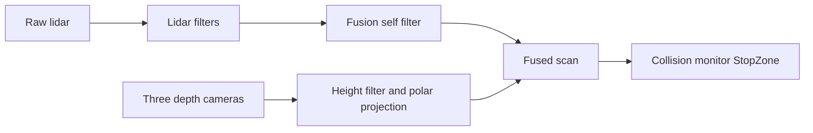

# StopZone diagnosis — 2026-11-12

Qwen detected the chair. The real approach was blocked at its start. The earlier saved observations did not identify that failure's live points; the fresh stationary capture below now identifies a lidar cluster sufficient to trigger the current StopZone. Keep the collision envelope and threshold while identifying the physical source.

## Fresh stationary capture — 2026-11-12 14:22

Capture: `logs/stopzone_20261112_142210/`. Its live parameters confirm the **v30** rectangle, x `[-0.67, 0.79]`, y `[-0.57, 0.57]`, and a four-point threshold. There are 100 observer samples and 17 saved snapshots. This analysis reads saved files only; it sends no ROS commands.

- **77 successful fused-scan projections, all above threshold:** 24–537 points. The other 23 samples had observer TF lookup errors and are excluded, not counted as clear.
- **After eight seconds, 24–34 points persist at the rear-right** in all 46 successful projections. The main cluster is approximately x `-0.39..-0.37`, y `-0.57..-0.48` m in `base_link`. A smaller intermittent cluster is near `(-0.62, -0.56)` m. Right means the rider's right; x is forward and y is left.
- **The persistent source is lidar.** In seven late snapshots with identical timestamps across raw `/scan`, `/scan_filtered`, `/scan_lidar_only` and `/scan_fused`, every fused StopZone hit has the same range and bin in all four stages. An eighth late snapshot matches the lidar-only stage exactly; its raw scan has a different stamp. Do not compare ranges from different stamps as if they were one frame.
- Front-camera returns contribute during the early part of the capture, then disappear from StopZone. The user reported sitting in front, which is a plausible explanation for that transient; the data does not label the object. Both side-camera overlays have zero StopZone hits in their successful projections. Camera merging therefore **does not explain the persistent rear-right group**.
- Saved laser-to-current-base transforms have translation x `0.47488..0.47549`, y `0.11998..0.12012`, z `0.07` m, and yaw within `0.0085` degrees of 180 degrees. These agree closely with the configured mount `(0.475, 0.12, 0.07)`. This checks consistency with configuration, not the physical calibration.
- The existing lidar self box ends at approximately y `-0.47` m in base coordinates; the persistent group lies just outside that edge. The CAD collision envelope does not establish that this group is wheelchair hardware: its rightmost castor is at the front, while these returns are at the rear. Do not enlarge the self box to suppress this group without identifying it.

The user subsequently reported nothing beside the rear-right wheel and that they were sitting about one metre to the side. That narrows the physical check but does not identify an unmodelled wheelchair part, a reflection, or a calibration error. A second stationary capture with the observer in a different known position will help separate external returns from returns fixed to the wheelchair. If the cluster stays, inspect/measure the actual hardware and sensor mounting at those coordinates before changing filtering.

**Limits:** Nav2 published no native collision markers or state during this idle capture (`native_samples: 0`). These are independently projected points sufficient for the live threshold, not a recorded new StopZone activation. The probe uses a 0.05 s TF wait, whereas the monitor is configured with a 1.0 s transform tolerance. The probe's future-extrapolation errors do not establish a monitor TF failure. No active `/scan_fused` sample exceeded its 2 s source timeout (maximum recorded age about 0.603 s); no missing monitor sources were recorded. Old front-camera debug messages sometimes exceeded 2 s, but that debug topic is not a direct collision-monitor source. The corresponding navigation log has no StopZone/invalid-source/TF failure messages in the capture window.

Artifacts beside the capture: `analyse_capture.py` (offline, reproducible), `analysis.json` (counts and same-stamp provenance), and `stopzone_analysis.png` / `.svg` (positions and timeline). Reproduce with `.venv-voice/bin/python -B logs/stopzone_20261112_142210/analyse_capture.py`. Its same-stamp range assertions passed. The existing CAD envelope check also passed. No navigation code, filters, speeds, acceleration limits, or protection polygons were changed.

The real stack had already shut down cleanly when a follow-up observation was considered. No relaunch or movement was performed by the agent.

## Confirmed evidence

- `logs/manual_nav_002711.log`: Nav2 accepted a goal from `(1.83, 1.42)` to `(2.91, 1.49)` at `1794424828.9049`. StopZone activated at `1794424828.9665`, about 62 ms later. The `(2.24, 1.46)` position mentioned earlier was an offline candidate, not this logged goal.
- The controller repeatedly reported `Failed to make progress`, cleared costmaps and retried. Those clears cannot remove a stop based on the collision monitor's live scan.
- The active v30 monitor uses `/scan_fused`, with a rectangle in `base_link`: x from `-0.67` to `0.79`, y from `-0.57` to `0.57`. It covers front, sides and rear. Clear floor in front alone does not establish that the whole zone is clear.
- In this installed Nav2/Jazzy implementation, `max_points: 3` means **four or more points** trigger the action. The deprecation warning is not the cause of the refusal.
- All three earlier stationary `/scan_fused` snapshots have zero points inside that rectangle. They are about 20 minutes before the failed approach; one fused snapshot also predates its accompanying raw scan. They cannot establish which points triggered the later stop or whether those points were false.

The lidar is mounted at base x=0.47, y=0.12, with 180-degree yaw. Raw scan angle zero looks behind the wheelchair. Diagnose positions after transforming them into `base_link`, including the translation.

## Fusion issue to investigate

`scan_fusion_v9.py` filters the lidar branch before merging the three camera overlays. Camera ranges are then merged directly, with no equivalent self filtering in that branch. A camera return on a wheelchair part can therefore be inserted into a scan whose lidar returns were already filtered. This is a code-level gap; it is not yet proof of what triggered last night's stop.



Do not blindly reapply the old angular exclusion sectors to camera data. Those sectors are not a full CAD geometry model and may also exclude nearby external obstacles. A fix must preserve returns on real walls, furniture and people.

## Prepared stationary capture

After the normal real-chair hardware checks, with the navigation stack already running and the chair stationary:

```bash
cd /home/aryan-raj/wheelchair_nav
source setup.bash --skip
.venv-voice/bin/python -B scripts/stopzone_probe.py --seconds 20
```

The observer submits no goals or motion messages. It reads the **live** monitor configuration rather than assuming a params file, then captures:

- `/scan`, `/scan_filtered`, the configured monitor scan, `/scan_lidar_only`, and the three per-camera debug scans.
- Per-scan stamps, ranges, geometry and transforms, using the same two-time odom/base-shift correction setting as the monitor.
- Nav2's actual transformed collision-point markers and state, plus its published StopZone polygon.
- Counts and coordinates inside StopZone, missing or stale sources, and TF errors.

Output goes to a new `logs/stopzone_<timestamp>/` directory: `parameters.json`, `events.jsonl`, bounded snapshot files and `summary.json`. Reusing an existing output directory creates a timestamped child and retains earlier captures. Coordinates use x positive forward, y positive left.

The native marker stream is `/collision_monitor/collision_points_marker`; Nav2 publishes it when processing velocity input and when a subscriber is present. If the monitor is idle, native markers may be absent. The observer independently projects fresh scans while stationary and explicitly distinguishes those projections from native monitor points. It never generates a command to wake the monitor. A quiet native stream is not evidence of a clear zone.

## Fix after identifying the points

| Evidence | Appropriate fix |
|---|---|
| Trigger points align with actual wheelchair parts | Correct self filtering for the contributing input using verified robot geometry in the correct frame, before nearest-range merging. Retain external obstacle returns. |
| A wall or object is projected into the wrong position | Correct the sensor frame/extrinsics or timestamp handling. Use the point-cloud message's actual coordinate frame and verify the transformed wall against the lidar. |
| Camera points falsely place the floor above its real height | Correct camera orientation/height or plane handling; preserve low obstacles. |
| The points belong to a real object/person at the side or rear | Clear that obstruction or reposition the chair. The static StopZone stops for any occupied region of the rectangle. |
| Monitor reports `invalid source` with stale data or missing TF | Restore the scan/TF pipeline; this is a separate failure from `StopZone`. |

After a sensor/fusion correction, repeat stationary captures and test obstacle preservation in simulation before a real approach. Wall returns, the target chair and low obstacles must remain detectable. Keep Qwen, speed/accel limits, StopZone and FootprintApproach protection while validating.

## Validation completed

`src/wheelchair_description/test/stopzone_probe_check.py` passed against the **actual installed Nav2 collision monitor** on isolated ROS domain 72. Synthetic scan/TF tests verified the backward lidar transform, the effective four-point threshold, three-point clear versus four-point stop, external obstacles outside the polygon, and stale-source stopping. The probe's projected and native monitor counts agreed. Its only publishers were ROS's automatic logging/parameter-event publishers; it had no motion publishers. No wheelchair hardware nodes or navigation actions ran. Test artifacts are under `bench_tmp/stopzone_20261112/`.

The fresh capture above establishes a present lidar group sufficient for StopZone, but its physical identity and its relationship to the earlier failed approach remain unconfirmed. No fusion filter, navigation limit or safety polygon was changed in this diagnostic work.

Implementation behavior was checked against the installed headers and [Nav2's Jazzy source](https://github.com/ros-navigation/navigation2/tree/jazzy/nav2_collision_monitor/src), including `scan.cpp`, `source.cpp`, `polygon.cpp` and `collision_monitor_node.cpp`. Context7 was unavailable in this session; official sources were fetched directly.
