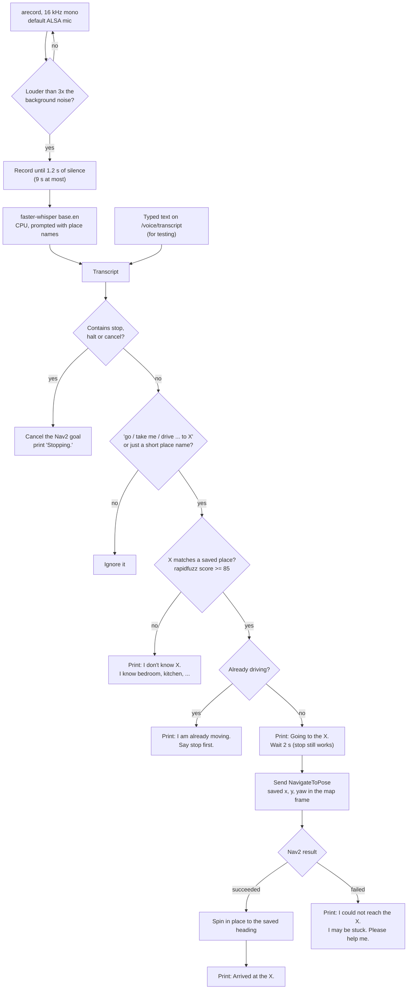
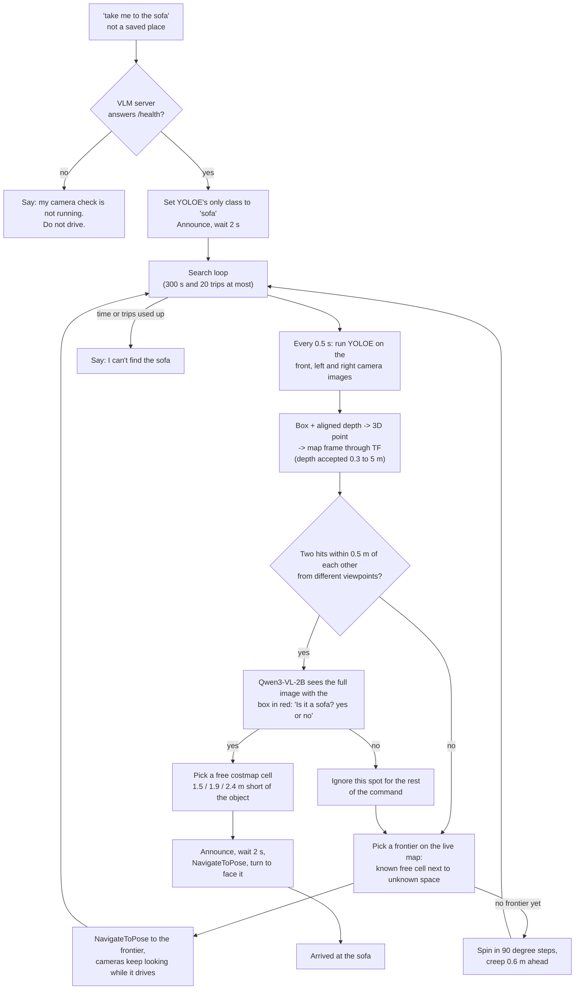
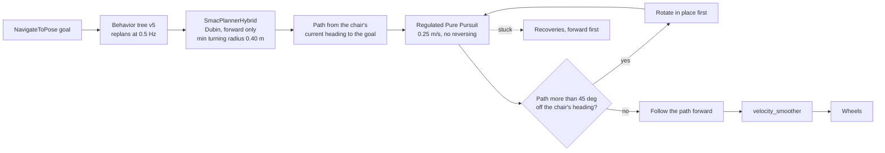

# How the wheelchair voice and VLM navigation works

This file explains, step by step, how the chair turns a spoken sentence into motion. Part 1 covers voice navigation to saved places (`voice_nav.py`, on the `voice-sim` branch). Part 2 covers finding an object the chair has never been told about (`object_nav.py`, on the `vlm-objnav` branch). Both parts share the same driving layer, described in Part 3, so read that one to understand how the chair actually moves, turns and avoids reversing.

Nav2 is the only thing that moves the wheels. The voice and VLM code pick a destination and can cancel it. Neither publishes a velocity command.

## Models used

| Job | Model | Where it runs | Used by |
|---|---|---|---|
| Speech to text | faster-whisper `base.en`, int8 | CPU | voice and VLM |
| Place-name matching | `rapidfuzz` fuzzy match (score at least 85), not a neural model | CPU | voice and VLM |
| Object detection | YOLOE `yoloe-26s-seg.pt`, with the spoken word as its only class | GPU (PyTorch) | VLM |
| Check that the detection is right | Qwen3-VL-2B-Instruct, GGUF Q4_K_M, served by llama.cpp `llama-server` on port 8091 | GPU | VLM |
| Steering the search toward likely areas (step B) | MobileCLIP-S2 through `open_clip` | GPU | VLM |
| Mapping | slam_toolbox (VLM mode) or a saved map with AMCL (voice mode) | CPU | both |
| Driving | Nav2: SmacPlannerHybrid, Regulated Pure Pursuit, behavior tree v5 | CPU | both |

The older prototype `vlm_nav.py` used Qwen2.5-VL 3B for both finding and checking objects. It is parked, because the 3B model accepted wrong objects.

---

## Part 1: Voice navigation to a saved place

### What it does

You say "take me to the kitchen". The chair transcribes the sentence, matches "kitchen" against the places saved in `config/locations.yaml` (bedroom, kitchen, living_room), and sends that pose to Nav2. The map is built earlier, and AMCL tells the chair where it is on that map.

### Flowchart

### Step by step

1. **Listening.** `arecord` streams 16 kHz mono audio in 30 ms chunks. A chunk counts as speech when its loudness is above three times the running background level, with a floor of 0.01. Recording stops after 1.2 s of quiet or 9 s total.
2. **Transcribing.** faster-whisper `base.en` turns the audio into text. It is given a hint such as "go to the bedroom, kitchen, living room. stop." so it spells the place names correctly.
3. **Understanding.** Two regular expressions decide what the text means. A "stop", "halt" or "cancel" anywhere cancels the current goal, and it is checked first, before anything else. A phrase like "go to / take me to / drive to X" extracts X. A bare place name also counts, because a pause often splits "take me to the" from "kitchen". Longer text with no command verb is ordinary conversation and is ignored.
4. **Matching.** `rapidfuzz` compares X with the saved place names. A score of 85 or more picks the place. Free text never becomes coordinates, so the chair can only go to places in the file.
5. **Announcing.** The reply is printed and published on `/voice/status`. The chair waits 2 s, and "stop" during that wait cancels the trip. Replies are not spoken, because the real chair has no speaker.
6. **Driving.** The node sends one `NavigateToPose` goal. Nav2 plans and drives (Part 3).
7. **Facing.** Nav2's config ignores the goal heading (`yaw_goal_tolerance: 6.28`). After arriving, the node reads the chair's heading from TF and calls the `Spin` action to turn to the saved yaw if it is more than 0.3 rad off.

### Safety rules in the code

- Closed vocabulary: only saved place names become goals.
- Announce, then wait 2 s, before moving.
- "Stop" has its own code path and works at any point.
- One goal at a time. A new destination while moving is refused.

### Why it used to reverse, and what changed

Going bedroom to kitchen, the path started behind the chair. The old config (v29) allowed reversing and used a planner that ignores the chair's heading, so the controller simply drove backwards along the path. The launch files now default to `nav2_params_3cam_v30.yaml` and `wheelchair_robust_nav_v5.xml`. The planner is forward-only (Part 3), so the chair turns around and drives forward. In the sim, kitchen, bedroom, kitchen succeeded with no negative `linear.x` on `/cmd_vel`.

---

## Part 2: Finding an object with the camera and VLM

### What it does

You say "take me to the sofa" in a building the chair has never mapped, or about an object that is not a saved place. The chair builds a map as it goes, searches on its own, confirms the object with a vision model, and drives to a free spot 1.5 to 2.4 m short of it. A saved place name still goes through Part 1. The VLM path only starts when the name does not match a saved place.

`object_nav.py` extends `voice_nav.py`, so the microphone, the stop keyword and the replies are the same. The code is on the `vlm-objnav` branch.

### Flowchart

### Step by step

1. **Check the VLM.** Before a search, the node pings the llama.cpp server. If it is down, the chair says so and does not drive to anything unverified.
2. **Set the target.** YOLOE is an open-vocabulary detector. `set_classes(["sofa"])` makes the spoken word its only class, so any object name works with no training.
3. **Look.** While a goal runs, the node looks every 0.5 s with all three RGB-D cameras (front, left, right). Each YOLOE box plus the aligned depth image gives a 3D point in the camera frame. TF converts it to the map frame. Depth outside 0.3 to 5 m is thrown away, because stereo depth gets noisy at range.
4. **Cluster.** One detection is never enough. A hit counts only when a second hit lands within 0.5 m of it from a different viewpoint: another camera, at least 0.3 m of travel, or at least 0.3 rad of turn. This removes one-frame false positives.
5. **Verify.** Qwen3-VL-2B gets the full frame with the box drawn in red and answers yes or no. The older prototype showed only a crop, and a wrong object passed 8 m from the real refrigerator. A "no" ignores that spot for the rest of the command. Any server error also counts as "no".
6. **Explore.** With no confirmed object, the chair explores the live slam_toolbox map. A frontier is a known free cell next to unknown space, at least 0.6 m long. Step A picks the frontier with the best `size / (distance + 1)`. Step B also weighs how much the area looks like the target, using MobileCLIP similarity between camera views and "a photo of a sofa". Frontiers already tried are skipped. A rejected detection does not mark a frontier as tried.
7. **Bootstrap.** Right after start-up the map has no frontier. The chair spins in 90 degree steps and creeps 0.6 m ahead until one appears.
8. **Approach.** Once confirmed, the chair announces the target, waits 2 s, drives to a free cell short of the object (trying wider angles if the first is blocked), then spins to face it.

### Limits and safety

- The search gives up after 300 s or 20 frontier trips.
- "Stop" cancels at any phase and is checked at least every 0.5 s.
- The VLM only proposes a target. Nav2 does the driving.
- Objects farther than 4 m are approached first and looked at again from closer.
- The sim object search was not completed end to end in a recorded run on this branch. Treat Part 2 as work in progress until the Task 8 protocol in `docs/superpowers/plans/2026-10-09-vlm-object-nav.md` has been run.

---

## Part 3: How the chair actually moves

Both parts end in the same call: `NavigateToPose` to Nav2. This is what happens next.

- **Map and position.** Voice mode loads a saved map and AMCL tracks the chair on it. VLM mode builds the map live with slam_toolbox. Both feed the costmaps that the planner and controller use.
- **Planning.** `SmacPlannerHybrid` is a Hybrid-A* planner. It starts from the chair's real heading and checks the chair's 0.9 by 0.7 m footprint along the path. With `motion_model_for_search: DUBIN` it only plans forward motion, with a turning radius of at least 0.40 m. If the goal is behind the chair, it plans a forward curve that turns the chair around. That is the "move like a real chair" behavior. The old `SmacPlanner2D` treated the chair as a point with no heading, which is why it often produced paths that started straight backwards.
- **Following.** Regulated Pure Pursuit drives at up to 0.25 m/s with `allow_reversing: false`. If the path points more than 45 degrees away from the chair's heading, it first rotates in place. It also stops if the footprint would hit something in the next second.
- **Smoothing.** `velocity_smoother` limits acceleration, and the command goes to the wheels (or to Gazebo's diff drive in the sim).
- **Recoveries.** If the chair is stuck, the v5 tree tries, once each per cycle and always forward first: clear costmaps, wait 3 s, spin 60 degrees left, spin 60 degrees right, back up 30 cm at 0.10 m/s, and as a last resort follow the path in reverse for at most 4 s at 0.10 m/s. If that fails, the tree gives up after about 17 s and the voice node says "I could not reach the X. I may be stuck. Please help me."
- **Not the saved path.** Nothing replays an earlier trip. Every goal is planned fresh from the current map, the current pose and the current obstacles.

## Part 4: Which files use the VLM

The VLM is Qwen3-VL-2B behind a llama.cpp server (or Qwen2.5-VL 3B in the parked prototype). Files marked "vlm-objnav only" do not exist on `voice-sim`.

| File | Branch | VLM role |
|---|---|---|
| `src/wheelchair_description/scripts/object_nav.py` | vlm-objnav only | Main node. Extends `voice_nav.py`, runs the search loop, calls the verifier before driving to an object. |
| `src/wheelchair_description/scripts/objnav_models.py` | vlm-objnav only | Wrappers for the YOLOE detector and the Qwen3-VL yes/no verifier (HTTP calls to the llama.cpp server). |
| `src/wheelchair_description/scripts/objnav_smoke.py` | vlm-objnav only | Smoke check that loads the models and calls the verifier once. |
| `src/wheelchair_description/scripts/objnav_value.py` | vlm-objnav only | MobileCLIP scorer that ranks frontiers (step B). Not a VLM, but feeds the same search. |
| `src/wheelchair_description/scripts/objnav_geometry.py`, `objnav_frontiers.py` | vlm-objnav only | Depth-to-map points, standoff goals and frontier choice. They produce the box and spot that the VLM checks, and never call it. |
| `src/wheelchair_description/scripts/objnav_vlm_server.sh` | both | Starts `llama-server` with Qwen3-VL-2B on port 8091. |
| `src/wheelchair_description/scripts/vlm_server.sh` | both | Starts the llama.cpp server for the older Qwen2.5-VL 3B prototype. |
| `src/wheelchair_description/scripts/vlm_nav.py` | both (parked) | Old prototype. Qwen2.5-VL 3B both finds and checks objects. |
| `src/wheelchair_description/scripts/voice_nav.py` | both | No VLM call. Has the `on_unknown` hook that `object_nav.py` uses to start a VLM search. |
| `src/wheelchair_description/urdf/wc_gazebo.xacro` | both | Side and front RGB-D cameras that supply the images and depth the VLM path needs. |
| `docs/examples/vlm_intent.example.json`, `docs/superpowers/plans/2026-10-09-vlm-object-nav.md` | both | Example intent format and the object-nav plan. |

### VLM changes so far

- 2026-10-09: added `objnav_vlm_server.sh`, then the geometry, frontier and model-wrapper modules, then `object_nav.py` (commit `6ff516c`). Added the `on_unknown` hook to `voice_nav.py` and `explore:=true` to `gazebo_sim.launch.py`.
- 2026-10-09: the verifier now sees the full frame with the box in red, not a crop, after a wrong object passed 8 m from the real refrigerator. Server errors count as "no".
- 2026-10-09: bootstrap spin and creep when the map has no frontier (`28de61e`). Side-camera colour and Nav2 without AMCL for the chair (`a5f01fd`).
- 2026-10-14: MobileCLIP value map for frontier choice (`ded236a`, work in progress) and the VLM object-search plan (`21305ec`).
- 2026-10-15: standoff spots are tried all the way round the object (`591c60e`).
- 2026-10-14: `voice_nav.py` prints replies instead of speaking them (`513e4ce`), which also applies to VLM replies.

## Running it

See `progress.md` for the full simulation commands. In short: enable loopback multicast once per boot, source `offline_env.sh`, launch `gazebo_sim.launch.py` with `nav2:=true` and the small house map, publish `/initialpose`, then start `voice_nav.py` from `.venv-voice`. The v30 params and v5 tree are now the launch defaults. For the VLM mode, check out `vlm-objnav` and follow Tasks 1 and 8 of the object-nav plan (`objnav_vlm_server.sh` starts the Qwen3-VL server).
